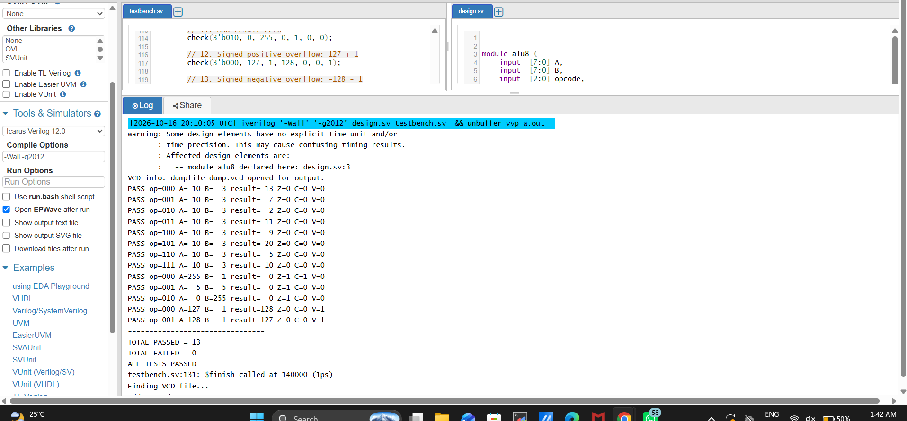
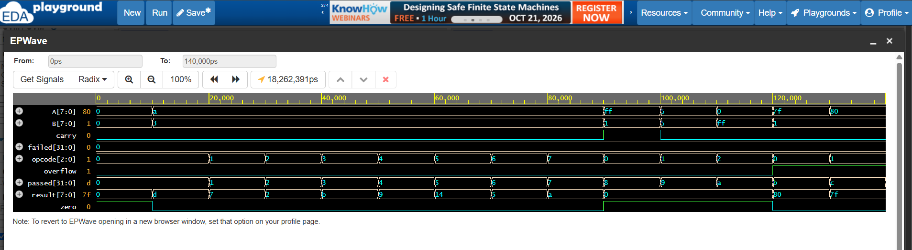

# 8-bit ALU in Verilog

An 8-bit combinational ALU with eight opcodes:
- `000`: Addition
- `001`: Subtraction
- `010`: AND
- `011`: OR
- `100`: XOR
- `101`: Shift left by one
- `110`: Shift right by one
- `111`: Pass A through

Flags: zero, addition carry-out, and signed overflow for addition/subtraction.

## Verification
The Icarus Verilog testbench runs 13 directed tests and creates `dump.vcd`.
Expected result: 13 passed, 0 failed. These directed tests are not exhaustive verification.

## Screenshots
### Simulation log

### EPWave waveform

